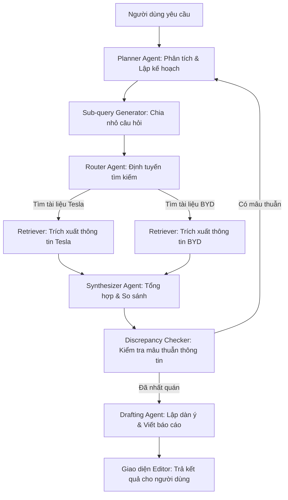

Ý tưởng của bạn là một bước tiến hóa tất yếu từ **RAG truyền thống (Naive RAG)** sang **Agentic RAG (RAG có tính tác vụ)**. 

Trong RAG truyền thống (như bản Desktop của AnythingLLM), bạn hỏi một câu, hệ thống tìm các mảnh tài liệu (chunks) tương tự rồi trả lời ngay. Cách này hoạt động tốt với các câu hỏi tra cứu nhanh kiểu *"Chính sách bảo hành là gì?"*. 

Tuy nhiên, với yêu cầu của bạn: **Đọc nhiều tài liệu, so sánh, tổng hợp thông tin, lập dàn ý và viết báo cáo**, hệ thống cần khả năng **suy nghĩ, lập kế hoạch và thực hiện nhiều bước (multi-step reasoning)**.

Dưới đây là bản thiết kế kiến trúc kỹ thuật và luồng hoạt động (blueprint) để bạn xây dựng ứng dụng này.

---

### 1. Luồng Hoạt Động Của Hệ Thống (Agentic Workflow)

Khi người dùng nhập yêu cầu: *"Hãy viết một báo cáo so sánh công nghệ pin của Tesla và BYD dựa trên các tài liệu tôi đã tải lên"*, hệ thống sẽ không trả lời ngay mà chạy qua một luồng công việc (workflow) có trạng thái (stateful loop):



#### Các bước chi tiết mà Agent sẽ tự thực hiện:
1.  **Planner Node (Lập kế hoạch):** Phân tích yêu cầu của người dùng, xác định các tài liệu cần đọc (ví dụ: các báo cáo kỹ thuật về Tesla và BYD đã tải lên).
2.  **Sub-query Node (Chia nhỏ nhiệm vụ):** Tự tạo ra các câu hỏi phụ:
    *   *Mật độ năng lượng pin của Tesla là bao nhiêu?*
    *   *Mật độ năng lượng pin của BYD là bao nhiêu?*
    *   *Chi phí sản xuất của mỗi bên là bao nhiêu?*
3.  **Research & Retrieve Node (Tìm kiếm song song):** Chạy RAG song song trên các tệp tài liệu cụ thể để thu thập câu trả lời cho các câu hỏi phụ.
4.  **Synthesizer Node (Tổng hợp & So sánh):** Đặt các thông tin cạnh nhau để so sánh đối chiếu (ví dụ: lập bảng so sánh ưu/nhược điểm).
5.  **Drafting Node (Viết báo cáo):** Dựa trên cấu trúc báo cáo chuẩn, viết bản nháp thô kèm trích dẫn nguồn (citation) từ tài liệu cụ thể để người dùng có thể kiểm chứng nguồn gốc thông tin.

---

### 2. Kiến Trúc Hệ Thống Đề Xuất (System Architecture)

Để ứng dụng chạy ổn định và dễ mở rộng, bạn nên chia hệ thống thành các lớp sau:

```
┌────────────────────────────────────────────────────────┐
│ UI/UX layer (Next.js + Tailwind)                       │
│ - Chat Interface (Giao tiếp với Agent)                 │
│ - Document Manager (Quản lý bộ nhớ/Workspaces)          │
│ - Split-screen Editor (Chat một bên, Soạn thảo một bên)│
└───────────────────────────┬────────────────────────────┘
                            ▼
┌────────────────────────────────────────────────────────┐
│ Backend Layer (Python FastAPI)                         │
│ - AI Agent Orchestrator (LangGraph / LlamaIndex Work) │
│ - Document Ingestion Pipeline (Docling / LlamaParse)   │
└───────────────────────────┬────────────────────────────┘
                            ▼
┌────────────────────────────────────────────────────────┐
│ Storage & DB Layer                                     │
│ - Vector Database (Qdrant / LanceDB)                   │
│ - Relational Database (PostgreSQL / Supabase)          │
└────────────────────────────────────────────────────────┘
```

---

### 3. Đề Xuất Tech Stack (Công nghệ khuyên dùng)

Hệ thống RAG dạng Agent đòi hỏi xử lý dữ liệu và AI rất nặng, do đó **Python** là lựa chọn tối ưu cho phần backend.

| Thành phần | Công nghệ khuyên dùng | Lý do lựa chọn |
| :--- | :--- | :--- |
| **Frontend** | **Next.js 15 (React 19) + Shadcn/ui** | Giúp xây dựng UI dạng split-screen (phân đôi màn hình: bên trái chat với tài liệu, bên phải hiển thị văn bản báo cáo đang viết nháp) rất mượt mà. |
| **Backend API** | **FastAPI (Python)** | Tốc độ cực nhanh, hỗ trợ stream dữ liệu (SSE - Server-Sent Events) giúp hiển thị câu trả lời dạng gõ chữ thời gian thực. |
| **Agent Orchestrator** | **LangGraph** (của LangChain) hoặc **LlamaIndex Workflows** | Đây là chìa khóa. **LangGraph** cho phép bạn định nghĩa các Agent dưới dạng máy trạng thái (state machine) có vòng lặp (loops) và điều kiện (conditional routing), rất phù hợp cho tác vụ lặp đi lặp lại để so sánh tài liệu. |
| **Document Parser** | **Docling** (của IBM) hoặc **LlamaParse** | Parser tài liệu cực mạnh. Đọc được cả cấu trúc bảng biểu phức tạp trong file PDF/Word để đưa vào vector DB dưới dạng Markdown định dạng chuẩn. |
| **Vector Database** | **Qdrant** hoặc **LanceDB** | Qdrant hỗ trợ lọc theo siêu dữ liệu (metadata filtering) cực tốt, giúp cô lập dữ liệu theo từng dự án/lĩnh vực cụ thể. |
| **LLM cho Agent** | **Claude 3.5 Sonnet** hoặc **Gemini 1.5 Pro** | Cần các mô hình có khả năng suy luận (reasoning) và lập kế hoạch (planning) mạnh mẽ nhất. Nếu chạy offline, có thể chọn **Qwen 2.5 72B** hoặc **Llama 3 70B** chạy qua Ollama. |

---

### 4. Các Tính Năng Độc Đáo Bạn Cần Build (Killer Features)

Để phần mềm của bạn thực sự vượt trội hơn các công cụ chat PDF thông thường trên thị trường:

1.  **Workspace / Knowledge Domain (Bộ nhớ cô lập):**
    Người dùng có thể tạo các "Không gian kiến thức" riêng (ví dụ: *Dự án A*, *Nghiên cứu thị trường B*). Khi chat ở không gian nào, Agent chỉ được phép truy xuất dữ liệu trong không gian đó.
2.  **Split-Screen Interactive Editor (Màn hình chia đôi tương tác):**
    *   **Bên trái:** Khung chat với Agent. Bạn nói: *"Hãy lập dàn ý báo cáo"*, Agent trả lời và cung cấp các nút *"Áp dụng dàn ý này sang editor"*.
    *   **Bên phải:** Trình soạn thảo văn bản (Rich Text Editor như TipTap hoặc Quill). Nội dung do Agent viết sẽ tự động đổ vào đây. Người dùng có thể tự chỉnh sửa thủ công ngay trên app.
3.  **Source Citations (Trích dẫn minh bạch):**
    Khi Agent viết báo cáo, mỗi khẳng định phải có một số chú thích nhỏ (ví dụ: `[1]`, `[2]`). Khi người dùng di chuột vào số đó, nó sẽ hiển thị một popover chứa đoạn văn bản gốc trong tài liệu nào, trang bao nhiêu để người dùng đối chiếu tức thì.
4.  **Human-in-the-loop (Tương tác giữa chừng):**
    Cho phép Agent dừng lại hỏi ý kiến người dùng: *"Tôi thấy tài liệu A nói doanh thu là 10 tỷ, tài liệu B nói là 12 tỷ. Bạn muốn tôi lấy số liệu nào cho báo cáo?"* trước khi tiếp tục viết.

### Hướng tiếp cận triển khai (Lộ trình cho bạn):
*   **Bước 1 (MVP):** Dựng UI Next.js đơn giản + API FastAPI. Dùng **LlamaIndex** để làm RAG cơ bản (tải tài liệu lên, lưu vào Vector DB local LanceDB và chat đơn giản).
*   **Bước 2 (Agentic):** Tích hợp **LangGraph** để xây dựng luồng Research Agent (nhận yêu cầu -> tự chia nhỏ câu hỏi -> tự truy vấn nhiều tài liệu -> tổng hợp lại một chỗ).
*   **Bước 3 (Editor):** Xây dựng màn hình soạn thảo tương tác để đồng bộ dữ liệu từ khung chat sang văn bản báo cáo.


Phân Tích & Gợi Ý Hướng Đi Cho Dự Án Của Bạn
Nếu bạn muốn build một ứng dụng tối ưu nhất cho ý tưởng của mình, bạn không nên copy nguyên một repo nào mà nên kết hợp tinh hoa từ chúng:

Giao diện người dùng (Frontend): Nên học theo cấu trúc giao diện của Kotaemon (cho phần đọc hiểu/tra cứu tài liệu nguồn) kết hợp với 302 Document Editor (cho phần soạn thảo văn bản). Người dùng sẽ có màn hình chia đôi:
Bên trái: Nơi quản lý Workspace tài liệu và Chat với Agent (GPT Researcher backend).
Bên phải: Trình soạn thảo văn bản dạng Rich Text (sử dụng thư viện Tiptap hoặc Quill) để biên tập báo cáo cuối cùng.
Luồng xử lý thông tin (Backend): Sử dụng GPT Researcher làm nhân xử lý. Khi người dùng ra lệnh: "Tổng hợp báo cáo so sánh kỹ thuật A và B", API sẽ kích hoạt luồng Agent của GPT Researcher chạy ngầm (background task). Khi hoàn thành, kết quả báo cáo Markdown hoàn chỉnh sẽ được đẩy thẳng vào trình soạn thảo bên phải để người dùng chỉnh sửa.